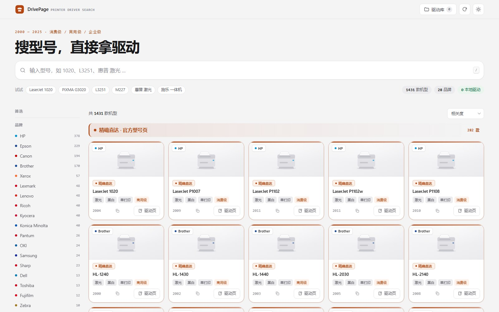

# DrivePage

离线打印机驱动检索工具。搜型号 → 看到外观 → 点一下拿驱动。



```
<安装目录>\
├─ index.html                  主界面（需要同目录 assets / drivers）
├─ Open DrivePage.cmd            稳定启动入口，不依赖 .html 默认关联
├─ DrivePage_standalone.html    单文件版（可直接分享）
├─ launch.py                    命令行启动器
├─ assets\
│  ├─ data.js                  机型数据集（想增补机型就改这里）
│  ├─ local-drivers.js         本地驱动索引（脚本自动生成，别手改）
│  ├─ app.js  styles.css
│  └─ app.ico  drivepage.ico   应用图标
├─ drivers\                    ★ 把下载好的安装包放这里
└─ tools\
   ├─ scan_drivers.py          扫描 drivers 目录生成索引
   ├─ make_shortcut.py         生成专属桌面快捷方式
   └─ 索引本地驱动.bat          双击运行
```

## 启动方式

桌面快捷方式默认 **Edge 应用窗口模式**（`--app=`）：独立窗口、没有地址栏和标签页，
配专属的“DrivePage”图标，看起来就是一个正经桌面软件。

也可以双击 `Open DrivePage.cmd` 启动，这条入口不依赖 Windows 的 `.html` 文件关联。

> 如果双击 HTML 出现“图形页面错误”、乱码或只是显示源码，通常是 Windows 的 `.html`
> 默认打开方式损坏。右键文件 → 打开方式 → Microsoft Edge → 勾选“始终使用”，
> 或直接使用 `Open DrivePage.cmd` / 桌面“DrivePage”快捷方式。

```
目标  C:\Program Files (x86)\Microsoft\Edge\Application\msedge.exe
参数  --app=file:///<安装目录>/index.html --window-size=1480,940 ...
```

想换回**普通浏览器标签页**打开：直接双击 `index.html`，或把快捷方式目标改成
`<安装目录>\index.html`（参数留空）。修改后运行 `python tools\make_shortcut.py` 重新生成快捷方式。

> 应用窗口模式下没有地址栏，所以界面右上角专门放了一个「重新加载」按钮（Ctrl+R 也可用）。

## 怎么用

1. **搜**：输入型号，支持模糊。
   `1020` / `l3251` / `m227` / `惠普 激光` / `施乐 一体机` / `g3020` 都能命中。
   按 <kbd>/</kbd> 直接聚焦搜索框，<kbd>Esc</kbd> 关闭详情。
2. **筛**：左侧按品牌 / 类型 / 色彩 / 功能 / 定位 / 年份区间组合筛选。
3. **下**：
   - 卡片按钮是 **「下载」**（实心）→ 本机已入库，点了直接下载，不联网。
   - 按钮是 **「官方页」**（描边）→ 本机没有，点开是该型号的官方驱动页。

## 让「官方页」变成「直接下载」

1. 从厂商官网把驱动安装包下下来，丢进 `drivers\`（文件名带上型号）。
2. 双击 `tools\索引本地驱动.bat`。
3. 回到应用刷新 → 对应机型立刻变成实心 **「下载」** 按钮。

也可以临时导入：应用右上角 **驱动库 → 选择文件夹**，选中任意目录即可（本次会话有效）。

## 关于数据

- 收录范围：2000–2025 年主流品牌的消费级 / 商用级 / 企业级机型，覆盖
  HP、Canon、Epson、Brother、Lexmark、Xerox、Ricoh、Kyocera、Konica Minolta、
  Sharp、OKI、Samsung、Dell、Lenovo、Pantum、Fujifilm、Toshiba、Zebra、TSC、
  佳博、得力、Star 等。
- **年份**是上市 / 主流在售年份，用于区间筛选，不是精确发布日。
- 卡片按“品牌 + 型号”自动去重；型号里已经包含的系列名不再重复显示，导出清单也同步清理这些冗余名称。
- 想加机型：编辑 `assets/data.js`，每行一条，格式
  `品牌|型号|系列|类型|色彩|功能|年份|级别`
  - 类型：`laser` / `inkjet` / `dotmatrix` / `thermal` / `wideformat`
  - 色彩：`mono` / `color`
  - 功能：`print` / `mfp`
  - 级别：`home` / `office` / `enterprise`

## 已知边界（说实话）

- 没有覆盖全部历史型号（全球 2000–2025 在售 + 历史型号数以万计），本库是**主流机型精选**，
  数据结构是开放的，可持续加。
- 除你放进 `drivers` 的安装包外，应用**不内置任何厂商驱动文件**；
  未入库的机型只能跳官方页——厂商基本都不提供稳定直链（CDN 动态带 token、版本一换就失效）。
- 官方支持页地址可能随厂商站点改版失效。

## 开发与构建

```bash
# 扫描 drivers/，生成本地驱动索引
python tools/scan_drivers.py

# 重新生成 Edge 应用窗口桌面快捷方式
python tools/make_shortcut.py

# 重新生成全部型号驱动清单（CSV + HTML）
python tools/export_drivers.py

# 重新生成单文件版
powershell -ExecutionPolicy Bypass -File tools/build_single_file.ps1
```

## 许可

[MIT License](LICENSE)
